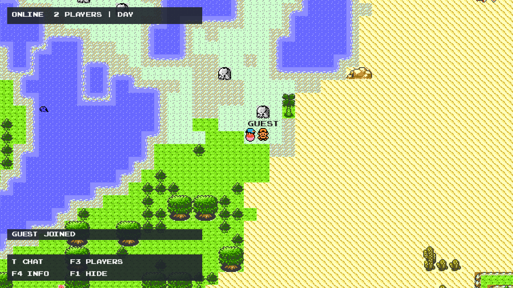

# PokeWilds-F

An unofficial PokeWilds v0.8.11 modification focused on multiplayer and quality-of-life improvements.

**Original game by [SheerSt and the PokeWilds contributors](https://github.com/SheerSt/pokewilds).** This fork is maintained by [whale2186](https://github.com/whale2186); it is not an official PokeWilds release. See [full credits and provenance](CREDITS.md).

[Download client releases](https://github.com/whale2186/pokewilds-f/releases) · [Dedicated server](https://github.com/whale2186/pokewilds-f-server) · [Multiplayer guide](docs/MULTIPLAYER.md)

## Screenshots



## Download and play

Download the **v0.1.3** package for your operating system, then extract the entire archive into a writable folder. **Java 11 is bundled; no separate Java installation is needed.**

| Platform | Download | Launch |
|---|---|---|
| Windows x64 | [Windows ZIP](https://github.com/whale2186/pokewilds-f/releases/download/v0.1.3/pokewilds-f-v0.1.3-windows-x64.zip) | Double-click `pokewilds-f.exe` |
| Linux x64 (glibc) | [Linux tar.gz](https://github.com/whale2186/pokewilds-f/releases/download/v0.1.3/pokewilds-f-v0.1.3-linux-x64.tar.gz) | Run `./start-client.sh` or `bash start-client.sh` |

Keep `jre/`, `lib/`, `config/`, and the launcher together. Windows launchers are unsigned. To join multiplayer, choose **JOIN**, open **Servers (A)**, add the server's address and TCP port (default **54555**), and select it.

Saves, settings and player identity are stored in the extracted folder's `runtime/`, not your home directory. Preserve that directory when upgrading. `PW_RUNTIME` can select an existing absolute runtime directory. Keep separate runtime directories for different local players. Windows client startup output is recorded in `runtime/launcher.log`.

Linux desktop execution and loopback multiplayer are tested. Windows package smoke checks can be run under Wine; this does not establish native-Windows graphical compatibility. The client needs a working desktop/OpenGL environment; the dedicated server does not. No Android APK or macOS package is included in v0.1.3. Earlier portable v0.1.0 packages remain available and require a separately installed Java runtime.

## Features

- Graphical LAN hosting and joining an independent headless dedicated server.
- Shared terrain/world Pokémon with revision-checked atomic edits and conflict handling; private bags and parties.
- Stable UUID player profiles that preserve progress when display names change.
- Saved player name, character, clothing color and skin color.
- Remote avatars, clothing/skin colors, followers and Pokémon field-action sprites.
- Smoothed remote player and wild-Pokémon movement.
- Chat, player counts, player list and responsive HUD.
- Player battles and spectating with the normal battle layout. Battle icons beside player names.
- Drop items from the bag as packs that other players can claim.
- Return to the main menu from the start menu; Save is shown only in single-player.
- Dedicated persistence, server console commands, world generation and creature simulation.

## Controls

| Action | Key |
|---|---|
| Move | Arrow keys |
| Confirm / interact | Z / A / Enter |
| Cancel / run | X |
| Main menu | Enter |
| Chat | **T**; Enter sends, Escape closes |
| Show/hide HUD | **F1** (hidden by default) |
| Online player list | **F3** |
| Watch a nearby battle | **F5** |
| HUD details | **F4** |

Messages appear for one second and fade over half a second. F1 displays retained messages; T opens scrollable history. Chat commands: `/help`, `/players`, `/clear`. Page Up/Down scrolls history or roster pages. The HUD adjusts to window size. Interact with a battling player and choose **Spectate**, or press F5 nearby. Esc or X leaves the spectator view.

## Hosting

For an independent server, use [pokewilds-f-server](https://github.com/whale2186/pokewilds-f-server). Match the client/server release versions. For graphical hosting, the release launcher also accepts engine arguments:

```bash
bash start-client.sh --coop-host=127.0.0.1:54555 --coop-name=Alice --coop-new=shared
# Later: replace --coop-new=shared with --coop-world=shared
```

Use a private/trusted LAN. This is experimental co-op, not an authenticated Internet service. One island per session; cross-island travel is blocked. Feature/progression coverage is incomplete, and abrupt interruption is not crash-proof distributed persistence. Back up saves. See [the multiplayer guide](docs/MULTIPLAYER.md).

## Build from source

The source tree contains the reconstructed Java engine and the fork's changes. Third-party libraries/assets are supplied in release assets, not Git history.

1. Install JDK 11 and Python 3.
2. Download the matching release ZIP. Copy its `lib/runtime-deps.jar` into a `vendor/` directory in this checkout (or copy `lib/` into the checkout).
3. Run:

```bash
bash scripts/dev.sh build
bash scripts/dev.sh run
python3 -m unittest discover -s tests -v
python3 scripts/fetch-java-runtimes.py
python3 scripts/package-release.py --version v0.1.3 --kind client --platform all
```

Compilation targets Java 8 bytecode. The tested execution environment is Java 11 on Linux. Graphical integration tests need a working X display. Platform packaging includes checksum-pinned Eclipse Temurin JREs with their notices; it excludes local saves, profiles and credentials. Windows .exe bootstraps are cross-compiled using `x86_64-w64-mingw32-gcc` (MinGW-w64).

## Attribution and rights

The editable engine was reconstructed from the public PokeWilds v0.8.11 release, not obtained from unpublished upstream sources. Game content and third-party components retain their existing rights; this repository does not grant a blanket license for them. Pokémon names and characters belong to their respective owners. Read [CREDITS.md](CREDITS.md) and [THIRD-PARTY-NOTICES.md](THIRD-PARTY-NOTICES.md).
